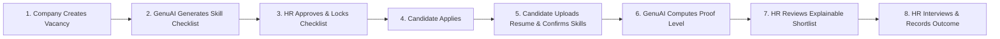

# GenuAI Technologies — Production Product Roadmap & Architecture Plan

This roadmap converts the GenuAI prototype into a disciplined, verifiable hiring product anchored on one end-to-end core journey.

---

## 1. The Core Product Spine (Step 1)

Every sprint, UI screen, API route, and test must serve this single end-to-end flow before expanding peripheral dashboards:



> [!IMPORTANT]
> **Proof-Level Rules (`skillProofService.js`):** Every checklist requirement on a candidate target resolves deterministically to one of four levels: `verified` (accepted external evidence) → `assessed` (official assessment ≥ 70% pass / ≥ 40% partial) → `claimed` (candidate-confirmed resume/profile skill claim) → `not_assessed` (`trainable` if adjacent skill proof exists or marked Preferred, else `missing`).

---

## 2. Design System & Component Audit (Steps 2–3)

### Existing vs. Target Design Tokens (`frontend/src/app/globals.css`)
GenuAI already has a custom CSS variable system in `globals.css` (without `shadcn/ui` or Radix). Refactoring in place avoids rewriting 77 routes while achieving token discipline:

| Token Category | Currently in `globals.css` | Action Needed |
|---|---|---|
| **Colors** | `--primary: #b8860b` (Gold), `--surface`, `--text-primary`, `--success`, `--warning`, `--danger`, `--border` | Keep CSS variables as single source of truth; decide brand palette alignment (current Gold `#b8860b` vs. Indigo `#4F46E5` + Teal `#0D9488`) before exporting Figma Variables |
| **Typography** | `Inter` + `Plus Jakarta Sans` loaded in `globals.css` | Standardize utility classes: `.heading-xl`, `.heading-lg`, `.heading-md`, `.body`, `.small`, `.caption` |
| **Spacing** | Ad-hoc inline `padding`/`gap` across pages | Enforce 4/8/12/16/24/32/48px scale via Tailwind spacing + layout tokens |
| **Radius & Shadows** | `--r-sm` (4px) to `--r-xl` (12px), `--shadow-xs` to `--shadow-lg` | Add `--r-full: 9999px` and semantic `--shadow-card`, `--shadow-modal`, `--shadow-dropdown` aliases |

### Reusable Component Inventory
* **Already Built (`frontend/src/components/admin/`):** `DataTable`, `DetailDrawer`, `ConfirmationDialog`, `FilterBar`, `KPICard`, `Modal`, `States`, `StatusBadge`, `ActivityTimeline`.
* **Extract Next into `frontend/src/components/ui/`:** `Button`, `Input`, `Select`, `Textarea`, `Checkbox`, `Radio`, `Toggle`, `Card`, `Badge`, `Tag`, `Tabs`, `EmptyState`, `LoadingState`, `ErrorState`, `SuccessBanner`, `ProofLevelBadge`.
* **Extract Next into `frontend/src/components/features/`:**
  * `vacancy/`: `VacancyCard`, `VacancyForm`, `SkillChecklist`, `ShortlistTable`
  * `candidate/`: `ResumeUpload`, `ProfileConfirm`, `ApplicationStatus`

### Core Screens Only (MVP Scope)
* **Company (`/dashboard/`):** Login → Dashboard → Vacancy Builder (`/vacancies/builder`) → AI Skill Checklist Review & Approval (`/vacancies/[id]`) → Applicant List & Explainable Shortlist (`/vacancies/[id]/readiness`) → Candidate Detail (`/vacancies/[id]/candidates/[candidateId]`) → Interviews & Outcome (`/interviews`).
* **Candidate (`/candidate/`):** Signup/Onboarding (`/onboarding`) → Target Role (`/target`) → Resume Upload & Skill Confirmation (`/profile`, `/evidence`) → Browse & Apply (`/vacancies`, `/vacancies/[id]`) → Assessment (`/targets/[id]/assessment`) → Proof Status (`/targets/[id]/coverage`) → Privacy & Consent (`/privacy`).
* **Admin (`/admin/`):** Login (`/login`) → Company Verification (`/verification/companies`) → Vacancy Moderation (`/verification/vacancies`) → Candidate Disputes (`/disputes`) → Overview (`/page`).

---

## 3. Target Architecture (Steps 4–5)

### Frontend (`frontend/src/`)
* **Central API Client:** `lib/api.ts` already exists (60s timeout + cold-start retry + token interceptor). Enforce rule: **zero raw `fetch()` or direct `axios` calls in pages**; wrap feature calls in typed `lib/api/*.ts` modules (`vacanciesApi.ts`, `shortlistApi.ts`, `candidateApi.ts`).
* **Polling Fix Applied:** `AuthContext.tsx` background sync interval reduced from `6000ms` to `60000ms` to eliminate unnecessary load on Render Free Tier while preserving `BroadcastChannel` + window focus instant sync.
* **Route Protection & Validation:** Enforce role guards in `dashboard/layout.tsx` (`COMPANY`), `candidate/layout.tsx` (`CANDIDATE`), and `admin/layout.tsx` (`ADMIN`), and run client-side schema validation before any mutation request.

### Backend (`backend/src/`)
Current routes contain embedded SQL queries and request validation. Refactor incrementally along the core spine without breaking live routes:

```
HTTP Request → routes/*.js → validators/*.js → controllers/*.js → services/*.js → models/*.js → PostgreSQL
```

| Layer | Existing | Refactor Priority |
|---|---|---|
| `services/` | `skillProofService.js`, `aiRoleBlueprintGenerator.js`, `officialAssessmentService.js`, `email.js` | Add `vacancyChecklistService.js`, `resumeParserService.js`, `shortlistService.js`, `hiringOutcomeService.js` |
| `controllers/` | *Missing (logic inside `routes/`)* | Extract controllers first for `shortlist.js`, `vacancies.js`, `skillClaims.js`, `admin.js` |
| `validators/` | `express-validator` installed in `package.json` | Add strict request schemas for vacancy creation, checklist approval, skill claims, hiring outcomes |
| `models/` | *Missing (raw `pool.query` everywhere)* | Create thin repository modules per domain (`vacancyRepo.js`, `candidateRepo.js`, `proofRepo.js`) |

---

## 4. Database Model Status (Step 6)

* **Existing Core Tables (Migrations V1–V27):** `users`, `companies`, `company_members`, `candidates`, `company_roles` (vacancies), `requirements`, `vacancy_versions`, `applications`, `targets`, `skill_claims`, `target_skill_proof`, `match_explanations`, `hiring_outcomes`, `assessment_attempts`, `assessment_results`, `assessment_sessions`, `official_assessment_questions`, `interviews`, `audit_logs`, `evidence`, `evidence_coverage`.
* **Added in Migration V28 (`migrate_v28.js`):**
  * `vacancy_skill_checklists` — explicit draft / AI-generated / approved / locked checklist versions per vacancy.
  * `resumes` — uploaded candidate resume metadata and raw extracted text.
  * `parsed_resumes` — structured extracted skills/experience/education pending `confirmed_by_candidate`.
  * `consent_records` — explicit privacy & data-processing consent audit trail.

---

## 5. Phased MVP Execution Plan (Step 7)

| Phase | Focus | Concrete Deliverables |
|---|---|---|
| **Phase 1: Backend Foundation** | Schema, auth, RBAC, checklist & application models | ✅ V27 & V28 migrations; extract `controllers/` + `validators/` for `vacancies`, `company`, `candidates`; lock cross-tenant authorization middleware |
| **Phase 2: Candidate Flow** | Signup, target role, resume upload, skill confirmation, apply | Wire `resumes` + `parsed_resumes` + `skill_claims` APIs; build `ResumeUpload` & `ProfileConfirm` components; enforce `consent_records` on `/candidate/privacy` |
| **Phase 3: Matching Engine** | Proof calculation, gaps, explainable shortlist | Connect `skillProofService` to `vacancy_skill_checklists`; persist `target_skill_proof` + `match_explanations` deterministically before adding optional LLM narrative |
| **Phase 4: Company Workflow** | Checklist approval, shortlist, candidate detail, outcome | Build `SkillChecklist`, `ShortlistTable`, `ProofLevelBadge`; connect `hiring_outcomes` & HR ranking override persistence |
| **Phase 5: Admin Controls** | Company verification, vacancy moderation, disputes, audit | Strip remaining mock arrays in `adminDataService.ts`; back all Admin tabs 100% with `admin.js` PostgreSQL queries + `audit_logs` |

---

## 6. Core-Flow Automated Test Matrix (Step 8)

Build `backend/tests/coreFlow.test.js` (Node native `node:test` + `assert`, zero heavy dependencies) covering all 10 critical guarantees:

1. Company creates a vacancy and approves/locks its `vacancy_skill_checklists` record.
2. Candidate applies to a published vacancy (creates `applications` + `targets`).
3. Candidate uploads resume (`resumes` / `parsed_resumes`) and confirms `skill_claims`.
4. **Tenant Isolation (Candidate):** Candidate A receives `403` when reading/updating Candidate B's claims, resumes, or targets.
5. **Tenant Isolation (Company):** Company A receives `403` when reading/updating Company B's vacancies, applicants, or shortlists.
6. `skillProofService` computes `not_assessed`, `claimed`, `assessed`, and `verified` accurately against thresholds (`70%` / `40%`).
7. Explainable shortlist API returns ranked candidates with per-skill `match_explanations` and `trainable` flags.
8. HR can record a ranking override with audit trail.
9. HR records structured `hiring_outcomes` (`rejected` | `offered` | `joined` | `on_hold`) once checklist & target exist.
10. Admin approves/rejects company verification and writes immutable `audit_logs`.

---

## 7. Deployment & Environment Checklist

| Environment | Purpose | Required Actions |
|---|---|---|
| **Local** | Rapid dev + automated tests | Keep `backend/.env` pointing to dev DB or test schema; run `npm run verify` + `npm test` before commit |
| **Staging** | Pre-production verification | Clone Render services (`genuai-backend-staging`, `genuai-frontend-staging`) + separate Supabase branch/project before live merges |
| **Production** | Live users | 1. Update `DATABASE_URL` in Render Dashboard for `genuai-backend` to the live Supabase pooler URL (removing reliance on `pool.js` fallback).<br>2. Set `NEXT_PUBLIC_API_URL=https://genuai-backend.onrender.com/api` on `genuai-frontend` in Render.<br>3. Run `npm run migrate && npm run verify` and `npm run build` on every release. |
