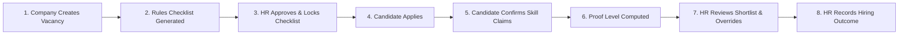

# GenuAI Technologies — Production Product Roadmap (Locked Scope)

This roadmap aligns all engineering work around one verifiable end-to-end hiring loop while deferring file storage/PII complexity and LLM generation to Release 2.

---

## 1. Locked Strategic Decisions

| Area | Decision | Details |
|---|---|---|
| **Brand & Design System** | **Keep Metallic Gold (`#b8860b` / `#d4af37`)** | Gold stays `--primary`/`--brand`; neutral dark grey text (`#191c1e`, `#444651`) on light `#f7f9fb` surfaces; subtle teal reserved strictly for verified proof/success states. All text & controls must meet WCAG 4.5:1 contrast. |
| **Phase 1 Scope** | **Core Proof-Shortlist Loop Only** | Controllers, validators, `vacancy_skill_checklists` (`draft` → `ai_generated` → `approved` → `locked`), candidate `skill_claims`, `skillProofService`, explainable shortlist + HR overrides, `hiring_outcomes`, tenant isolation, and core-flow integration tests. |
| **Deferred to Release 2** | **Resumes, Parsing & LLM** | `resumes` / `parsed_resumes` endpoints, file uploads, virus scanning, signed URLs, full `consent_records` enforcement, and external LLM checklist/explanation generation remain deferred (`v28` tables exist safely via expand-first schema strategy). |

---

## 2. The Core Product Spine

---

## 3. Phase 1 Deliverables & Status

| Item | Status | Location |
|---|---|---|
| Schema V28 (`vacancy_skill_checklists`, `resumes`, `parsed_resumes`, `consent_records`) | ✅ Applied | [migrate_v28.js](file:///C:/Users/safik/Desktop/GenuAI%20New/backend/src/database/migrate_v28.js) |
| Schema V29 (`shortlist_overrides`) | ✅ Added | [migrate_v29.js](file:///C:/Users/safik/Desktop/GenuAI%20New/backend/src/database/migrate_v29.js) |
| Request Validators (`vacancies`, `shortlist`, `skillClaims`, `company`, `candidates`, `admin`) | ✅ Implemented | `backend/src/validators/` |
| Controllers + Services (`vacancyChecklistService`, `shortlistService`, `skillClaimService`, `auditService`) | ✅ Implemented | `backend/src/controllers/`, `backend/src/services/` |
| Candidate Auth & Tenant Isolation (`requireCandidate`, `requireCompany`) | ✅ Hardened | [auth.js](file:///C:/Users/safik/Desktop/GenuAI%20New/backend/src/middleware/auth.js) |
| Core-Flow + Tenant-Isolation Integration Tests (12 Acceptance Criteria) | ✅ Added | [coreFlow.test.js](file:///C:/Users/safik/Desktop/GenuAI%20New/backend/tests/coreFlow.test.js) |

---

## 4. Release 2 Scope (Deferred After Core Loop Sign-Off)

1. Resume upload endpoint with magic-byte validation, file-size caps, malware scanning, private signed object URLs, and deletion/retention controls.
2. `parsed_resumes` extraction service + candidate confirmation screen.
3. `consent_records` gating before PII/resume processing.
4. Optional external LLM checklist & explanation enrichment (`generated_by = 'ai'`) backed by deterministic fallbacks.
5. Frontend `components/ui/` & `components/features/` extraction + WCAG contrast audit across Gold primary buttons/badges.
